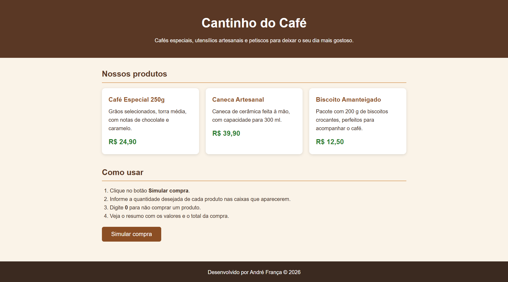

# Cantinho do Café — Simulador de Compra

- **Aluno:** André França Monteiro
- **Trilha:** Trilha Desenvolvimento Mobile

## Apresentação da loja

O **Cantinho do Café** é uma loja fictícia de cafés especiais e acessórios. A página apresenta os produtos e permite simular uma compra por meio de caixas de diálogo do navegador.

| Produto | Descrição | Preço |
|---|---|---|
| Café Especial 250g | Grãos selecionados, torra média | R$ 24,90 |
| Caneca Artesanal | Cerâmica feita à mão, 300 ml | R$ 39,90 |
| Biscoito Amanteigado | Pacote de 200 g | R$ 12,50 |

## Tecnologias

- HTML5
- CSS3
- JavaScript (puro)

## Como executar

1. Clone o repositório: `git clone https://github.com/andrefrancamonteiro/simulador-de-compras`
2. Abra o arquivo `index.html` em qualquer navegador (não precisa de servidor).
3. Clique em **Simular compra** e responda às perguntas.

## Estrutura do projeto

```
index.html   -> estrutura da página
style.css    -> estilos
script.js    -> função simularCompra()
README.md    -> documentação
```

## Captura de tela



## Testes realizados

| Teste | Entrada (café / caneca / biscoito) | Resultado esperado | Resultado |
|---|---|---|---|
| Compra normal | 2 / 1 / 3 | Total R$ 127,20 | OK |
| Só um produto | 0 / 2 / 0 | Total R$ 79,80 | OK |
| Tudo zero | 0 / 0 / 0 | "Nenhum produto foi selecionado." | OK |
| Valor inválido | `abc` | Alerta de erro e nova pergunta | OK |
| Número negativo ou decimal | `-1` ou `1.5` | Alerta de erro e nova pergunta | OK |
| Cancelar o prompt | Cancelar | "Simulação cancelada." | OK |

## Dificuldade encontrada e aprendizado

**Dificuldade:** Tive dificuldade para pensar em todos os casos onde as respostas seriam inválidas e como tratá-las. Além disso, também tive um pouco de dificuldade para fazer referências aos arquivos css e js.

**O que aprendi:** Conectar arquivos css e js ao index.html e tratamento de respostas inválidas.

## Uso de Inteligência Artificial

- **Como a IA ajudou:** gerou a estrutura inicial dos arquivos HTML, CSS e JavaScript.
- **O que adaptei:** Modifiquei cores e mensagens dentro dos arquivos index.html. Também usei para melhorar o posicionamento de alguns itens dentro da página.
- **Como verifiquei:** abri a página no navegador e verifiquei se as cores tinham sido alteradas de fato e verifiquei se os itens tinham ficado visualmente melhores.
